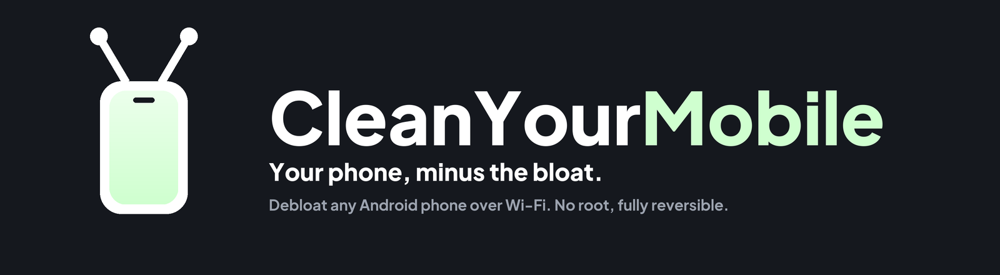
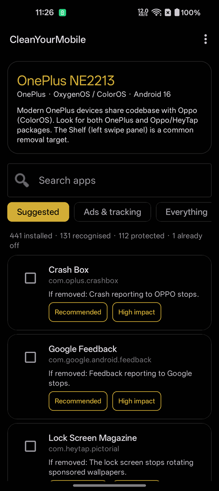
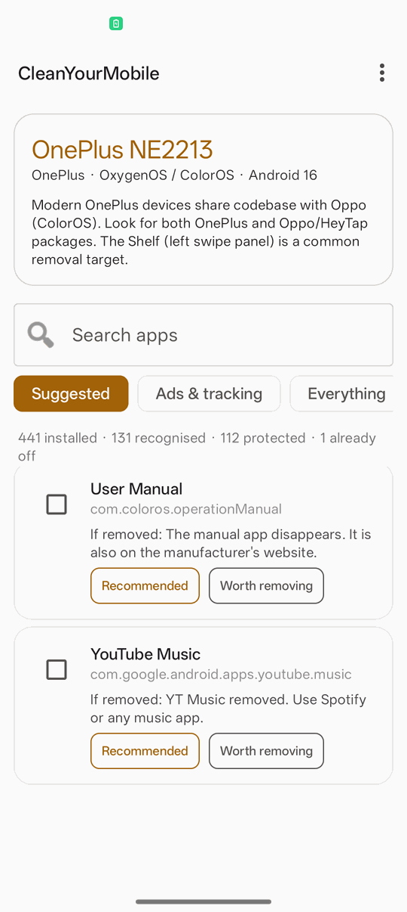

<p align="center">
  
</p>

<p align="center">
  <b>Your phone, minus the bloat.</b><br>
  Strip the ads, trackers, telemetry and preinstalled junk from any Android phone.<br>
  <b>Now Shizuku compatible</b> — run it on the phone itself with
  <a href="CleanYourMobile.apk">the app</a>, or from a computer over USB or Wi-Fi.<br>
  <b>No root. Nothing permanently deleted. One-line restore.</b>
</p>

<p align="center">
  <a href="https://github.com/0xgh0stri13y/Clean-Your-Mobile/stargazers"></a>
  <a href="https://github.com/0xgh0stri13y/Clean-Your-Mobile/network/members"></a>
  <a href="https://github.com/0xgh0stri13y/Clean-Your-Mobile/graphs/contributors"></a>
  <a href="https://github.com/0xgh0stri13y/Clean-Your-Mobile/issues"></a>
  <a href="LICENSE"></a>
  <a href="#safety"></a>
  <a href="#the-android-app"></a>
  <a href="CleanYourMobile.apk"></a>
</p>

<p align="center">
  <b>505 packages</b> across <b>15 brand families</b> ·
  <b>202</b> never-touch entries · <b>no</b> external dependencies
</p>

## About

**CleanYourMobile** is an autonomous, safety-first debloating framework for Android smartphones. It strips carrier bloat, lock screen ad carousels (Glance, magazine feeds), vendor ad daemons (MIUI MSA), background telemetry, and redundant OEM clones over local Wi-Fi or USB.

Inspired by [CleanYourTV](https://github.com/Gathin23/cleanyourtv), it brings the same transparent, reversible approach to phones:
- **No root required** — Uses standard Android Debug Bridge (`adb`) user-space commands (`pm uninstall -k --user 0`).
- **Zero brick risk** — The read-only system partition stays untouched. Nothing is permanently deleted.
- **Audited offline database** — 505 packages mapped across 15 brand families, each detailing what it does and what breaks if removed.
- **3-layer safety guard** — 202 essential packages (phone calls, SMS, emergency alerts, biometrics, camera, Play Services) are permanently locked from removal.
- **Instant rollback** — An automatic restore script is generated before the first app is touched.

## Start here

There are three ways to use this, in order of how much you have to set up.

| You have | Go to | Effort |
|---|---|---|
| **Only the phone** | [The Android app](#the-android-app) — [`CleanYourMobile.apk`](CleanYourMobile.apk) runs on the phone through [Shizuku](https://shizuku.rikka.app/), Android 11+ | Lowest |
| **A phone and a computer** | [Quick start](#quick-start) — a coding assistant does the work in about ten minutes | Low |
| **A computer, no assistant** | [Doing it by hand](#doing-it-by-hand) — the same scripts, run by you. The best-tested path | Medium |
| **An iPhone** | Nothing here applies. iOS has no debug bridge of this kind and no preinstalled bloat to remove | — |
| **Want to see it first** | [What a scan looks like](#what-a-scan-looks-like) — real output from a real phone | — |

**Use it:** [The Android app](#the-android-app) · [Quick start](#quick-start) ·
[Doing it by hand](#doing-it-by-hand)

**Understand it:** [How it works](#how-it-works) ·
[What a scan looks like](#what-a-scan-looks-like) · [What you get](#what-you-get) ·
[Supported phones](#supported-phones) · [Safety](#safety)

**When you need it:** [Restoring](#restoring-your-phone) ·
[System updates](#after-a-system-update) ·
[When something goes wrong](#when-something-goes-wrong) ·
[Questions](#questions-people-ask) · [Contributing](#contributing)

## The Android app

[`CleanYourMobile.apk`](CleanYourMobile.apk) runs the same database on the phone itself, with no
computer involved once [Shizuku](https://shizuku.rikka.app/) is started. The source is in
[`android/`](android/).

| | |
|---|---|
|  |  |
| *Dark, true OLED black* | *Light* |

**It is a reference implementation, not a product.** It exists to show that the database and the
three-layer guard port cleanly to Android. For everyday use on a phone,
[Canta](https://github.com/samolego/Canta) is more mature, more complete and has thousands of
users; the honest comparison is in [the FAQ](#how-does-this-compare-to-canta-and-shizuku).

### Installing it

| Step | What to do |
|---|---|
| **1. Shizuku** | Install it from the [GitHub release](https://github.com/RikkaApps/Shizuku/releases), not the Play Store build, which is older and has no Android 16 support. |
| **2. Start it** | Pair over Wireless debugging on Android 11+, or start it from a computer over ADB. Android clears it on every reboot, so this has to be done again after each restart unless the phone is rooted. |
| **3. Install the APK** | Download [`CleanYourMobile.apk`](CleanYourMobile.apk) and open it. Android will ask you to allow installs from your browser or file manager. |
| **4. Grant access** | Open the app and tap **Grant access**; Shizuku asks you to confirm. |

Android 8.0 (API 26) or newer for the app itself; Android 11 or newer to start Shizuku without a
computer.

### What it does

| | |
|---|---|
| **Reads the same database** | All 505 packages, copied in from `database/` at build time, so the APK cannot ship a stale copy. |
| **Detects the brand** | The same scoring as `tools/cym.py`, including the alias bonus that catches "Redmi" and "iQOO" reporting themselves as something other than their maker. The brand's notes appear at the top of the screen. |
| **Shows what you lose** | Every row carries its `if_removed` line, which is the field this whole project exists for. |
| **Sorts by impact** | Advertising and telemetry first, manufacturer features last. A separate axis from the safety rating: a preinstalled compass and a lock-screen ad carousel are both "Recommended", but only one is doing you harm. |
| **Refuses what it must** | The same three layers, and `Guard.kt` is a fourth copy of the pattern generated from `scripts/lib.sh`. On a OnePlus 10 Pro it holds back 112 packages. |
| **Backs up first** | A full snapshot of the phone before the first change, plus a restore record written before the first package comes off and an exportable text file of the undo commands. |
| **Disables, never deletes** | `pm disable-user --user 0`. **Restore all** switches everything back on. |
| **Shows what it cannot rate** | A package the database has no entry for is listed under **Unrated** rather than quietly left out, which is what used to happen. It is shown and never offered: an unrated package is evidence for a human, not a verdict. |
| **Presets** | **Export preset** saves what you actually switched off as a portable JSON profile; **Import preset** reads one from a file or the clipboard, re-checks every package against the database and the guard, and then only ticks the boxes. Nothing is applied by an import. The format is the same one [`tools/preset.py`](tools/preset.py) reads, so a profile moves between a phone and a computer either way. |
| **Light or dark** | True `#000000` OLED black or a warm light theme, with a toggle under **Appearance**. Every colour pair passes the 4.5:1 contrast requirement. |

### What is verified, and what is not

Tested on a OnePlus 10 Pro (NE2213), Android 16, OxygenOS 16.0.3:

| Verified on hardware | Not yet exercised |
|---|---|
| Scan, brand detection, the guard holding back 112 packages | **Uninstall mode** — the code exists but the interface only calls disable |
| All four Shizuku states, and the permission grant | Batching at scale: every test run has been a single package |
| The privileged disable (`enabled 0 → 3`) and restore (`3 → 1`) | The three-consecutive-failure abort |
| The backup snapshot and the exported undo file | The between-batch health check |
| The light and dark themes, search, filters, selection | Any phone other than the one above |
| | Preset export and import, and the **Unrated** list — they compile and the validation is covered by its command-line twin, but neither has been run on a phone yet |

The command-line tools are the better-tested path by a wide margin: they have been run against two
brands and a real 32-package removal, which is where most of this project's bugs were found.

### Building it yourself

```bash
gradle -p android assembleDebug      # build only
gradle -p android publishApkRelease  # build, then copy the signed APK to the root
```

Needs JDK 17 and the Android SDK, platform 35 with build-tools 34 or newer. `database/` is read
from one level up; the build **fails** rather than producing an APK with no never-touch list.

`Guard.kt` holds the **fourth** copy of the protected-name pattern, generated from
`scripts/lib.sh`. Never edit it by hand — run `python tools/sync_guard.py`, which checks that all
four copies agree.

The published APK is a **signed release build**. Its signing key is held outside the repository
and never committed, so the certificate below identifies builds that actually came from here:

```
Signer certificate DN:  CN=0xgh0stri13y, OU=CleanYourMobile, O=CleanYourMobile
SHA-256 digest:         bf068b12ebc1c7f97ecaa33f312b19f69f0f97b8d1bfc6f0a164561712ca7782
```

Check any copy you download with
`apksigner verify --print-certs CleanYourMobile.apk`. A different digest is not this build.
If you would rather not trust a binary at all, the build above reproduces it from source.

**More:** [`android/README.md`](android/README.md).

## How it works

Every Android phone has the same debug bridge developers use. Switch on USB debugging in the
phone's developer options, allow your computer once, and the rest is standard Android tooling:

| Step | What happens |
|---|---|
| **Measure** | Every installed package, plus RAM, storage, battery, processes, services, and how many apps hold your location, camera, microphone and contacts permissions. |
| **Scan** | Each package is matched against a database of 505 known packages: what it is, what it does, and what you lose if it goes. Anything unrecognised is reported as unrecognised. |
| **Ask** | A plan grouped by category, each line saying what breaks. You delete whatever you want to keep. Nothing is touched before you approve it. |
| **Remove** | With `pm uninstall -k --user 0`, which removes an app for your user profile only. The copy on the read-only system partition stays. Five at a time, with a health check between batches. |
| **Measure again** | The same numbers after a reboot, side by side with the first set. |

**No root, no system partition written, nothing deleted, and a one-line restore if you change your
mind.** The restore record is written before the first removal, not after the last one, so it
covers everything even if the run is interrupted.

The bloat differs by brand and by region, so the scan reads your phone rather than trusting a list,
and asks before touching anything you might be using.

## Quick start

| You have | Do this |
|---|---|
| **A computer with a coding assistant** | Use the prompt: the three steps below. |
| **A computer, no coding assistant** | Run the three steps yourself: the commands are in [Doing it by hand](#doing-it-by-hand). |

The steps below are written for a coding assistant. The computer needs a shell, Python 3.8 or
newer, and either a USB cable or the phone on the same Wi-Fi network. No SDK, no JDK, nothing to
`pip install`.

Any of these work: [Claude Code](https://claude.com/claude-code),
[Codex](https://github.com/openai/codex),
[Gemini CLI](https://github.com/google-gemini/gemini-cli),
[Antigravity](https://antigravity.google) or Cursor.

| Where | What to do |
|---|---|
| **1. On the phone** | Settings → About phone → tap **Build number** seven times → back → Developer options → **USB debugging** on. If you want to work without a cable, turn on **Wireless debugging** too. Keep the screen unlocked. |
| **2. On your computer** | Clone the repository and open that folder in your assistant (`git clone https://github.com/0xgh0stri13y/Clean-Your-Mobile`), then paste [`PROMPT.md`](PROMPT.md) and fill in your phone's model. |
| **3. Follow along** | Accept "Allow USB debugging?" on the phone, then answer the checklist: how far to go, and which of the manufacturer's apps you actually use. |

Cloning matters: the assistant reuses this repository's `scripts/debloat.sh` and `tools/scan.py`
instead of writing its own, and that is where the never-touch guard, the batching, the health
checks and the restore record live. An assistant improvising `pm uninstall` loops has none of them.

With this repository as context it takes about ten minutes.

## Doing it by hand

Everything the assistant does, you can run yourself. One thing has to be on the computer first:

| You need | For |
|---|---|
| **Python 3.8 or newer** | The tools in `tools/`. They import nothing outside the standard library, so there is nothing to install. |

The Android platform tools are installed by the first script if they are missing, from Google's own
download. Nothing below needs root, and `--dry-run` changes nothing at all.

```bash
git clone https://github.com/0xgh0stri13y/Clean-Your-Mobile
cd clean-your-mobile

bash scripts/setup_adb.sh                 # install the platform tools if missing
bash scripts/connect.sh                   # USB; --wireless to pair over Wi-Fi
bash scripts/snapshot.sh before           # measure, and open a session

python tools/scan.py --plan               # match the database, write plan.txt
                                          # --level recommended | advanced | expert

bash scripts/debloat.sh backups/<session>/plan.txt --dry-run   # read this first
bash scripts/debloat.sh backups/<session>/plan.txt             # apply it

adb reboot && adb wait-for-device
bash scripts/snapshot.sh after
python tools/report.py                    # report.md, report.json, report.txt
```

| Tool | What it does |
|---|---|
| [`scripts/setup_adb.sh`](scripts/setup_adb.sh) | Installs the Android platform tools: Homebrew or your package manager first, Google's official zip as a fallback. |
| [`scripts/connect.sh`](scripts/connect.sh) | Finds the phone over USB, pairs over Wi-Fi with a pairing code, or moves a trusted USB phone onto Wi-Fi. Explains each failure instead of printing the adb error. |
| [`scripts/snapshot.sh`](scripts/snapshot.sh) | Measures packages, RAM, storage, battery, processes, services and permission holders into one session directory, as readable text and as JSON. |
| [`tools/explain.py`](tools/explain.py) | Looks up a package name with no phone attached: what it is, what you lose if it goes, whether the guard refuses it and why, and the command that undoes each change. `--search` explores by keyword, `--json` feeds other tools. |
| [`tools/scan.py`](tools/scan.py) | Reads the phone, detects the brand, matches all 505 database entries, and writes a plan with each line's consequence beside it. `--from-list` scores a saved package list with no phone attached. |
| [`tools/preset.py`](tools/preset.py) | Saves a curated list as a named, portable profile: apply it to a second phone, pull it back after a factory reset, export it as JSON, share it. It stores package names only and resolves every rating from the database each time, so a profile never carries stale ratings. On import and on apply, every package goes back through the guard, and a file with a malformed package name is rejected whole rather than applied in part. |
| [`scripts/debloat.sh`](scripts/debloat.sh) | Applies a plan: refuses anything protected, batches of five, a health check between batches, stops after three consecutive failures, verifies each removal, and writes the restore record before the first one. |
| [`scripts/restore.sh`](scripts/restore.sh) | Puts a session back, all of it or one package or every session on record, and verifies each one. |
| [`tools/report.py`](tools/report.py) | Compares the two snapshots and the two package lists. Spots packages that came back on their own, and says which numbers are real. |
| [`tools/check.py`](tools/check.py) | Compares the phone with the plan that was applied, for what a system update put back. `--fix` re-applies it; `--quiet` is an exit code for a scheduled job. |
| [`tools/validate_db.py`](tools/validate_db.py) | Database integrity: the schema, duplicates, ratings that disagree across brands, and the one that matters, anything on the never-touch list rated as removable. |

Your own plans can live outside the repository: plan paths are relative to the directory you run
from, and absolute paths work too.

<details>
<summary><b>Windows (PowerShell)</b></summary>

Every device script has a PowerShell twin next to it. The Python tools are the same everywhere.

```powershell
powershell -ExecutionPolicy Bypass -File scripts\setup_adb.ps1 -Persist
powershell -ExecutionPolicy Bypass -File scripts\connect.ps1
powershell -ExecutionPolicy Bypass -File scripts\snapshot.ps1 before

python tools\scan.py --plan

powershell -ExecutionPolicy Bypass -File scripts\debloat.ps1 backups\<session>\plan.txt -DryRun
powershell -ExecutionPolicy Bypass -File scripts\debloat.ps1 backups\<session>\plan.txt

adb reboot; adb wait-for-device
powershell -ExecutionPolicy Bypass -File scripts\snapshot.ps1 after
python tools\report.py
```

Restore with `scripts\restore.ps1`, which takes `-Package <name>` for one app, `-List` to see what
is on record, or `-All` for every session.

These are written for Windows PowerShell 5.1, so they also work on PowerShell 7. They are plain
ASCII on purpose: 5.1 reads a script without a byte-order mark as ANSI, and one emoji in the file
breaks the parse before a single line runs.

</details>

<details>
<summary><b>How the scripts protect your phone</b></summary>

Three checks stand between a plan and a package, and a package has to clear all three.

**1. The never-touch list.** [`database/essential_packages.json`](database/essential_packages.json)
holds 202 entries covering phone calls, SMS, emergency alerts, SIM services, Wi-Fi, Bluetooth,
camera, keyboard, launcher, Settings, Play Store, Play Services, keystore, system UI, the setup
wizard and permission management. A package on it is refused. There is no flag to override this,
and the scripts refuse to run at all if the file is missing or parses as empty, rather than
proceeding without a guard.

**2. The protected-name pattern.** An unusual ROM has packages no list has seen. Anything whose
name matches a protected category is also refused: `systemui`, `telephony`, `dialer`, `incallui`,
`inputmethod`, `keystore`, `launcher`, `setupwizard` and a dozen more, plus build-time
infrastructure such as runtime resource overlays, framework resources, GPU drivers and graphics
layers. A OnePlus 10 Pro carries more than thirty of those, none of them an app anyone installed.
`CYM_ALLOW_PROTECTED=1` relaxes this one check for the rare ROM that names a theme store
`...launcher.themes`. It does not relax the never-touch list.

This pattern is written out in three files, [`scripts/lib.sh`](scripts/lib.sh),
[`scripts/lib.ps1`](scripts/lib.ps1) and [`tools/cym.py`](tools/cym.py), on purpose. The
duplication means no single file being wrong or missing can disarm the guard.

**3. What the phone is using right now.** `tools/scan.py` asks the phone which launcher owns HOME
and which keyboard is the active input method, and drops both from the plan whatever the database
says about them. `scripts/debloat.sh` checks that something still answers HOME before it starts and
again after it finishes.

On top of that: batches of five with a health check between each, which sends HOME and then
confirms the package service still answers, because a phone that cannot run `cmd package` cannot be
restored either; an automatic attempt to put the last batch back if that check fails; and a stop
after three consecutive failures, since that means something systemic changed rather than one
awkward package.

`python tools/validate_db.py` enforces the consistency these rely on. An entry on the never-touch
list rated anything but `Unsafe` is an error rather than a warning, because a tool that looked it
up and saw `Expert` would offer to remove what the other guard refuses.

</details>

## What a scan looks like

Real output, from a OnePlus 10 Pro running OxygenOS 16 with 439 packages installed. Nothing is
changed at this stage:

```
$ python tools/scan.py --plan

 Device : OnePlus NE2213 (OP516FL1), Android 16 / API 36
 Installed packages : 439
 Already disabled   : 3
 Brand profile      : OnePlus  (OxygenOS / ColorOS)
 Plan level         : recommended

What the database recognises on this phone
  Recommended    28   safe for everyone
  Advanced       71   safe for most, may touch minor OEM features
  Expert         17   power users, have replacements ready
  Unsafe         15   never removed, shown so you know they were seen
  Unknown       213   not in the database, never planned automatically

The plan: 28 package(s) at level 'recommended'

  Advertising (1)
    * com.heytap.pictorial
      Lock Screen Magazine - Pushes sponsored wallpapers to the lock screen
      If removed: The lock screen stops rotating sponsored wallpapers.

  Telemetry and analytics (7)
    * com.oplus.stdid
      Standard ID Service - Serves a tracking identifier to preinstalled apps
      If removed: Preinstalled apps lose a device-level advertising identifier.

  Partner and third-party preloads (4)
    * com.teamviewer.quicksupport.market
      TeamViewer QuickSupport - Lets a helper view your screen remotely
      If removed: Remote support sessions stop being possible. Nothing else changes.

Kept back: 112 package(s)
  x android                                        on the never-touch list
  x com.android.cellbroadcastreceiver              on the never-touch list
  x com.oplus.securitykeyboard                     on the never-touch list
  x com.android.launcher                           on the never-touch list
```

Every line says what you lose, not just what goes. Then the dry run, which also changes nothing:

```
$ bash scripts/debloat.sh backups/<session>/plan.txt --dry-run

 In the plan        : 28
 Will be processed  : 28
 Refused (protected): 0

 Method  : pm uninstall -k --user 0 (data kept, system copy kept)
 Batches : 28 packages, 5 per batch, health check after each

Batch 1 of 6
  [ 1/28] com.heytap.pictorial                             would uninstall
  [ 2/28] com.coloros.compass2                             would uninstall

 DRY RUN - nothing on the phone was changed
```

<details>
<summary><b>And the report it writes at the end</b></summary>

`tools/report.py` compares the two snapshots and writes `report.md`, `report.json` and
`report.txt`. The figures below are an example, not a measurement of the phone above:

```
$ python tools/report.py

Measured
                                       before         after            change
  Installed packages                      412           365        -47 (-11%)
  RAM available                      2,539 MB      3,271 MB       +732 (+29%)
  Running services                         96            74        -22 (-23%)
  Apps with location access                31            24         -7 (-23%)
  Apps with microphone access              22            16         -6 (-27%)
  Apps with contacts access                26            19         -7 (-27%)

Honest reading of these numbers
  47 fewer packages is the one number that is exactly true.
  More free RAM is real, but Android fills free RAM with cache by
  design, so this figure drifts on its own. Measure it twice.
  Battery life cannot be measured in minutes. Fewer background
  services means less wakeup work, but judge it over a few days.
```

That last section is printed by the tool, not written by hand.

</details>

## What you get

A phone that stops working against you.

| Gone | What that means in practice |
|---|---|
| **Lock screen advertising** | Xiaomi's wallpaper carousel, the vivo and OPPO magazine, Glance. The lock screen stops selling you things. |
| **Advertising inside system apps** | MIUI's MSA framework, OPPO's ad service, the sponsored cards in the swipe-right panel. |
| **Advertising notifications** | On Tecno and Infinix phones the worst offender is a single package. |
| **Telemetry** | Analytics, usage reporting, diagnostic uploads and crash telemetry going to the manufacturer. |
| **Duplicated apps** | The manufacturer's browser, gallery, music player, file manager, notes and calculator that you never open because you already have better ones. |
| **Partner preloads** | Facebook's background services, preinstalled games, shopping apps, and the installer that keeps adding more of them. |
| **Carrier apps** | Account apps, support apps, and the folder of sponsored apps on the home screen. |

And a measurement of what changed rather than a claim about it:

| Measured exactly | Measured, but noisy | Not claimed at all |
|---|---|---|
| Packages removed | Free RAM, because Android fills it with cache by design | Battery life in hours |
| Apps holding location, camera, microphone, contacts and SMS permissions | Running services and processes | Any multiple of "faster" |
| Which advertising is gone | Free storage, which barely moves because the system copy stays | A benchmark score |

The report says which is which, in those words. It is printed by the tool rather than written by
hand, so it cannot drift into marketing.

## Supported phones

Anything running **Android 7 or newer** with developer options available. The database covers these
brand families by name:

| Brand | Packages | OS | Main targets |
|---|---:|---|---|
| **Samsung** | 92 | One UI | Bixby, AR Zone, Samsung Free, Galaxy Store, Knox extras |
| **OnePlus** | 81 | OxygenOS | Shelf, HeyTap remnants, ColorOS telemetry, factory test tools |
| **Xiaomi, Redmi, POCO** | 62 | MIUI, HyperOS | MSA ad framework, wallpaper carousel, App Vault, analytics |
| **Google, Pixel** | 52 | Stock Android | Unused Google apps, Android System Intelligence, Chrome |
| **OPPO** | 37 | ColorOS | HeyTap, lock screen magazine, ad service, Theme Store |
| **vivo, iQOO** | 36 | Funtouch OS, OriginOS | Jovi, V-Appstore, magazine, EasyShare |
| **Motorola, Lenovo** | 19 | Near-stock | Moto Genie, Gametime, Device Help, Moto Voice |
| **Huawei, Honor** | 19 | EMUI, MagicOS | Huawei and Honor Video, Reader, SkyTone, App Market |
| **realme** | 13 | realme UI | HeyTap, realme Store, Game Space |
| **ASUS** | 12 | ZenUI | Game Center, log uploader, duplicated apps |
| **Tecno, Infinix, itel** | 9 | HiOS, XOS | Advertising notifications, Phoenix Browser, Carlcare |
| **Nothing** | 1 | Nothing OS | Very little. Nothing OS is already clean |
| **Carrier** | 21 | any | Verizon, T-Mobile, AT&T, Jio, Airtel, Vodafone |
| **Universal** | 64 | any | Facebook services, Microsoft Office, preinstalled games and shopping |

**Your brand not listed?** The universal, Google and carrier entries still apply, and the scan
reports every package it does not recognise with the reason it looks suspicious, as evidence for
you to judge rather than as something it removes on its own. Add your brand afterwards and the next
person with your phone skips that step: [CONTRIBUTING.md](CONTRIBUTING.md).

**Not supported:** iPhones, and any phone where an employer's management profile has removed
developer options. On a work-managed phone, don't: see [Safety](#safety).

## Safety

| | |
|---|---|
| **Nothing is deleted** | `pm uninstall -k --user 0` removes an app for your user profile. `-k` keeps its data, and the copy on the read-only system partition is untouched. `--disable` is more conservative still: `pm disable-user` removes nothing at all. |
| **No root, ever** | No `su`, no exploit, no bootloader unlock, no system partition write, no boot image touched. This cannot brick a phone. |
| **The restore record comes first** | Written before the first removal and appended as each package comes off. If the run dies halfway, the record already covers everything up to that point. |
| **A factory reset is the floor** | It always works, and every system package comes back, because none of them were ever deleted. |
| **Nothing leaves your computer** | No telemetry, no API calls, no network access from the phone. The only outbound request in the project is downloading the platform tools from `dl.google.com`, and only if adb is missing. |
| **Never touched** | Phone and dialer · SMS and MMS · emergency alerts · SIM services · Wi-Fi · Bluetooth · camera · keyboard · home launcher · Settings · Play Store · Play Services · keystore and security · system UI · setup wizard · permission management |

Every package carries a rating, and you choose how far a plan goes:

| Rating | Means | Enters a plan at |
|---|---|---|
| **Recommended** | No side effects for anyone. Advertising, telemetry, dead weight. | `--level recommended` and up |
| **Advanced** | Safe for most people. A minor manufacturer feature goes with it. | `--level advanced` and up |
| **Expert** | An ecosystem feature goes with it, or data has to be moved first. | `--level expert` only |
| **Unsafe** | Never removed. Listed so a scan can report that it saw it. | never |

**Two cases where you should not do this.** A phone managed by your employer, or with a work
profile: removing Knox or Device Policy components breaks the management and may breach their
policy. And a phone under warranty where you are about to make a claim. Nothing here is detectable
after a factory reset, but the honest answer is that changing a phone's software can affect support.

**Two things a restore cannot undo**, both rated Expert and both saying so in the database: data
left inside a Secure Folder or Knox container when you remove it, and NFC transit or access cards
provisioned to a manufacturer's wallet. Move those out first. The full list is in
[docs/RESTORE.md](docs/RESTORE.md#what-a-restore-cannot-undo).

## Restoring your phone

Keep the session. One line puts the phone back the way it was:

```bash
bash scripts/restore.sh                            # the newest session
bash scripts/restore.sh --package com.foo.bar      # one app
bash scripts/restore.sh --list                     # every session on record
bash scripts/restore.sh --all                      # all of them, oldest first
```

| What | How |
|---|---|
| **A record comes first** | Before `scripts/debloat.sh` changes anything it writes down what it is about to do, in the session directory under `backups/`. |
| **It verifies** | A package counts as restored only when it is installed for your user and not disabled, rather than because the command returned success. |
| **It reads the record** | Not a generated script, so it still works if that was edited or lost. |
| **It tries both routes** | A package may have been uninstalled or disabled, and running the wrong undo is a no-op. |
| **No computer?** | The phone's own Settings → Apps page, with system apps shown, can re-enable packages too. |
| **Factory reset** | The guaranteed floor. Every system package comes back, because none were deleted. |

**More:** [docs/RESTORE.md](docs/RESTORE.md) has what the record holds, why this is reversible at
all, what to do when a package will not come back, and the handful of things a restore genuinely
cannot undo.

## After a system update

A system update installs a fresh system image over the cleaned-up one: the packages you removed
come back, disabled ones are often re-enabled, and new preloads appear that no plan mentions. This
is expected rather than a failure. Compare the phone with the plan you applied, and `--fix` puts it
back:

```bash
python tools/check.py           # what came back
python tools/check.py --fix     # re-apply the same plan
python tools/check.py --quiet   # exit code only, for a scheduled job
```

`--fix` goes through the same guard, so a hand-edited plan still cannot reach a protected package.
The result is appended to the session's log with the new patch level, so a phone's history stays in
one place.

A few database entries remove the manufacturer's updater, among them Motorola's
`com.motorola.ccc.ota` and OnePlus's `com.oplus.sau`. They are rated Expert, they say so in their
`if_removed` text, and they are never in a conservative plan. Removing one means the phone stops
receiving security patches, not just features.

**More:** [docs/FIRMWARE.md](docs/FIRMWARE.md) has the exit codes, a weekly check, and finding the
new preloads an update added that no plan mentions.

## When something goes wrong

The full list of things that bit us is in [docs/TROUBLESHOOTING.md](docs/TROUBLESHOOTING.md). The
three that matter most:

- **The phone shows as `unauthorized`.** The "Allow USB debugging?" dialog has not been accepted,
  and it cannot appear while the screen is locked. Unlock it, replug, and watch the screen. If the
  dialog never comes, use Developer options → **Revoke USB debugging authorizations** and try again.
- **Notifications from one app stopped.** A manufacturer push service went with the removal:
  `com.heytap.mcs` on OPPO, OnePlus and realme, `com.vivo.pushservice` on vivo, `com.xiaomi.xmsf`
  on Xiaomi. Apps that use Firebase are unaffected, which is why this only ever hits preinstalled
  ones. Put the one package back with `bash scripts/restore.sh --package com.heytap.mcs`.
- **`Failure [DELETE_FAILED_INTERNAL_ERROR]`.** The ROM is refusing. Usually the app is a device
  administrator, which you turn off in Settings → Security first, or a work profile owns it. Try
  `--disable` instead, which some ROMs accept where `uninstall` is blocked.

Nothing here can brick a phone. `adb reboot` fixes most of it, because nothing was deleted.

## Questions people ask

<details>
<summary><b>Will this brick my phone?</b></summary>

No, and the reason is structural rather than a promise. Nothing is deleted: `pm uninstall -k
--user 0` removes an app for your user profile only, and the copy on the read-only system partition
stays exactly where it was. No root is used, no partition is written, and no boot image is touched.

Worst realistic case: the phone misbehaves, you reboot it, and if that is not enough you run the
restore script. If the phone will not talk to a computer at all, its own Settings → Apps page can
re-enable things with no computer involved. A factory reset is a guaranteed floor and brings back
every system package, because none were ever removed from the system image.

</details>

<details>
<summary><b>Do I need root?</b></summary>

No, and this project will not use it. Everything works through switches Android offers the owner of
the device: developer options, ADB debugging, and `pm disable-user` or `pm uninstall --user 0`, the
same mechanism as Settings → Apps → Disable, driven from a shell instead of a screen.

Rooting would let you delete packages properly, and it would also void warranties, trip hardware
security keys such as Samsung Knox, break banking apps, and make a mistake permanent. That trade is
not worth it for removing Bixby.

</details>

<details>
<summary><b>Will my phone actually be faster?</b></summary>

Some of it is real and some of it is not, and the report separates the two rather than flattering
you.

Real and measured: fewer packages, fewer apps holding your location, camera, microphone, contacts
and SMS permissions, fewer running services, and the specific advertising that is now gone. You
notice the last one the same day.

Real but slow: battery life. Fewer background services means less wakeup work, but it cannot be
measured in an hour. Judge it over a few days.

Mostly not real: free RAM, as a number. Android fills spare RAM with cache on purpose, so the
figure moves on its own, and it often drops right after a reboot while caches warm. Storage barely
changes, because the system copy of every removed app is still there, which is exactly why all of
this is reversible.

Anyone promising a multiple of "faster" is selling something.

</details>

<details>
<summary><b>Will banking and payment apps still work?</b></summary>

Normally yes. Removing apps for your user profile does not change the system image and does not
trip Play Integrity by itself. What can cause trouble is removing Samsung Knox components or parts
of Play Services, both rated Expert or Unsafe here and never in a conservative plan.

If a banking app starts refusing after a run, restore the session and re-run at
`--level recommended`.

</details>

<details>
<summary><b>What about my work phone?</b></summary>

Don't. A phone managed by your employer has a device policy controller that this would interfere
with, removing Knox or Device Policy components breaks the management, and it may be against the
policy you agreed to. The prompt asks about this and will offer only the most conservative level
when you say yes.

A personal phone that merely has a work profile is less dramatic, but packages owned by that
profile cannot be removed from your user anyway.

</details>

<details>
<summary><b>Will a system update undo everything?</b></summary>

Mostly, yes. A system update reinstalls the system image over the cleaned-up one. That is expected
and is not a failure.

`python tools/check.py` tells you exactly what came back, and `--fix` re-applies the same plan in
one command. See [After a system update](#after-a-system-update).

</details>

<details>
<summary><b>Can I speed up the animations too?</b></summary>

Yes, if you ask during the run. It is a display setting rather than a speed-up: the phone is not
faster, it just stops waiting.

```bash
adb shell settings put global window_animation_scale 0.5
adb shell settings put global transition_animation_scale 0.5
adb shell settings put global animator_duration_scale 0.5
```

The before snapshot records your original values under **Animation scales**. The restore script
does not revert these, because they are not package changes, so put them back by hand with `1.0`.

</details>

<details>
<summary><b>Is there an app that does this on the phone itself?</b></summary>

Yes — just not this one, which is a set of scripts that run on a computer.

Removing a system app needs shell-level privileges. An app on the phone gets them one of two ways:
root, or [Shizuku](https://shizuku.rikka.app/), which on **Android 11 and newer** starts from the
phone's own Wireless debugging with no computer and no second device involved. The catch is that
Android clears it on every reboot, so you restart Shizuku each time you restart the phone unless
you are rooted.

[Canta](https://github.com/samolego/Canta) is the app to use for that, and it also has a web
version that drives a phone over USB from a Chromium browser with nothing installed at all.
[Universal Android Debloater](https://github.com/Universal-Debloater-Alliance/universal-android-debloater-next-generation)
is the desktop equivalent. Both are independent projects, not affiliated with this one, and this
database credits their lists as a source.

See [how the two compare](#how-does-this-compare-to-canta-and-shizuku) for which to pick.

</details>

<a id="how-does-this-compare-to-canta-and-shizuku"></a>

<details>
<summary><b>How does this compare to Canta and Shizuku?</b></summary>

They solve the same problem from opposite ends, and for a lot of people Canta is the better
answer. [Canta](https://github.com/samolego/Canta) is an Android app (LGPL-3.0, Android 9+) that
uses Shizuku for shell privileges and runs on the phone. This is a scripted toolkit that drives
ADB from a computer.

| | Canta | CleanYourMobile |
|---|---|---|
| **Runs on** | The phone itself, via Shizuku. Also a web version over USB | A computer, over ADB |
| **Needs a computer** | No, on Android 11+ | Yes |
| **Interface** | A GUI you tap through | A CLI, or a coding assistant driving it |
| **Setup** | Install the app, start Shizuku, restart it after each reboot | Enable USB debugging, clone the repo |
| **Package data** | The Universal Debloat List | This repository's own database, with an `if_removed` line per package |
| **Hard refusal of critical packages** | No. It surfaces recommendations and lets you decide — its own README warns that removing critical apps can bootloop the phone | Yes. 202 never-touch entries with no override, plus a name pattern and a live launcher/keyboard check |
| **Batching and health checks** | No | Five at a time, package service verified between batches, stops after three consecutive failures |
| **Before and after measurement** | No | RAM, storage, services, and permission-holder counts, with the noisy figures labelled as noisy |
| **Post-update drift** | Detects apps you previously removed | `tools/check.py` diffs against the applied plan and `--fix` re-applies it |
| **Maturity** | Thousands of users, on F-Droid and Play | Much newer and far less battle-tested |

**Pick Canta if** you want this done in ten minutes with no computer, you are comfortable deciding
for yourself what is safe, or you are doing one phone once.

**Pick this if** you want to read what each removal costs before approving it, you want the
guard to refuse rather than warn, or you want a measured before-and-after and a restore record you
can replay.

They are not really competitors. Canta is more accessible; this is more cautious and more
instrumented. Using Canta on your own phone and this on a relative's would be a perfectly sensible
combination.

</details>

<details>
<summary><b>How is this different from CleanYourTV?</b></summary>

[CleanYourTV](https://github.com/Gathin23/cleanyourtv) does this for Android TV, and installing a
replacement launcher is the main event there. This is the same idea pointed at phones, where the
problem is different: no launcher replacement is needed, the brands and packages are entirely
different, and the cost of removing the wrong thing is much higher. A TV with no dialer is fine; a
phone with no dialer is not.

So the emphasis here is the guard and the database rather than a new home screen. Credit where it is
due: CleanYourTV is why this exists.

</details>

## Project layout

```
clean-your-mobile/
├── PROMPT.md                     # paste this to your coding assistant
├── AGENTS.md                     # the rules an agent must follow, binding
├── CONTRIBUTING.md               # how to add packages and brand profiles
├── CODE_OF_CONDUCT.md            # be decent
├── SECURITY.md                   # what counts as a vulnerability, and how to report it
├── .github/                      # issue templates and the pull request checklist
├── database/
│   ├── debloat_db.json           # 505 packages: what they are, what you lose
│   ├── essential_packages.json   # 202 never-touch entries, no override
│   └── brand_profiles.json       # 13 brand profiles and their quirks
├── scripts/                      # anything that talks to the phone
│   ├── lib.sh / lib.ps1          # the adb wrapper, sessions, and the guard
│   ├── setup_adb.sh / .ps1
│   ├── connect.sh / .ps1
│   ├── snapshot.sh / .ps1
│   ├── debloat.sh / .ps1
│   └── restore.sh / .ps1
├── tools/                        # cross-platform Python, standard library only
│   ├── cym.py                    # shared: adb, database, sessions
│   ├── explain.py                # look up one package, no phone needed
│   ├── preset.py                 # portable, shareable removal profiles
│   ├── scan.py                   # scan and build a plan
│   ├── report.py                 # before and after
│   ├── check.py                  # what a system update put back
│   └── validate_db.py            # database integrity
├── CleanYourMobile.apk           # the Android app, built and ready to install
├── android/                      # its source: Kotlin, Shizuku, the 4th guard copy
├── docs/
│   ├── TROUBLESHOOTING.md        # every failure mode and how to get out of it
│   ├── DATABASE.md               # the schema, the safety ratings, the guard
│   ├── RESTORE.md                # why this is reversible, and the four ways back
│   ├── FIRMWARE.md               # system updates that undo your work
│   ├── banner.png                # the banner at the top of this page
│   └── app/                      # screenshots of the Android app
└── backups/                      # one directory per session, git-ignored
```

## Contributing

The most useful contribution is a package from your phone that the database does not know yet, so
the next person with that model does not have to rediscover it.
[CONTRIBUTING.md](CONTRIBUTING.md) has the format and the testing we ask for.
Contributing through a coding agent? [AGENTS.md](AGENTS.md) gives it the same rules.

| How to help | What it means | Start with |
|---|---|---|
| **A package entry** | The most useful one. A scan that says "not in the database" is a gap you can close. | [Package issue](../../issues/new?template=package.yml) |
| **A correction** | A rating that is too generous, or an `if_removed` that turned out to be wrong. **Worth more than new entries.** | [Package issue](../../issues/new?template=package.yml) |
| **A brand profile** | Sony, ZTE, Nubia, Meizu, Sharp, Lava, anything nobody has described yet. | [Brand issue](../../issues/new?template=brand.yml) |
| **A `special_notes` paragraph** | The thing you learned the hard way about your brand. No tool can derive it. | [Brand issue](../../issues/new?template=brand.yml) |
| **A troubleshooting entry** | A failure you hit and how you got out of it. | [Bug report](../../issues/new?template=bug.yml) |

The one thing we ask: test it on a phone you own, then use that phone for a day. A package that
breaks something subtle, such as notifications from one app, a camera mode, or emergency alerts,
will not show up in the first five minutes. And `python tools/validate_db.py` has to pass.

```bash
python tools/validate_db.py     # database integrity
python tools/sync_guard.py      # all four copies of the guard still agree
bash -n scripts/*.sh            # shell syntax
```

The [pull request template](.github/PULL_REQUEST_TEMPLATE.md) lists these, plus the four rules from
[AGENTS.md](AGENTS.md) that a change to the tools cannot break. Be decent while you are here:
[CODE_OF_CONDUCT.md](CODE_OF_CONDUCT.md).

## Contact

| For | Where |
|---|---|
| **My phone is misbehaving right now** | [docs/TROUBLESHOOTING.md](docs/TROUBLESHOOTING.md) first — nothing is deleted, so a reboot fixes most of it |
| **Is it safe to remove X?** | [Discussions](https://github.com/0xgh0stri13y/Clean-Your-Mobile/discussions) |
| **A package to add or correct** | [Package issue](../../issues/new?template=package.yml) |
| **A brand with no profile** | [Brand issue](../../issues/new?template=brand.yml) |
| **Something went wrong** | [Bug report](../../issues/new?template=bug.yml) |
| **Security issues** | Privately, through the Security tab. See [`SECURITY.md`](SECURITY.md) |

## Legal

- CleanYourMobile is an independent open-source project. It is not affiliated with, endorsed by or
  sponsored by any phone manufacturer, carrier or platform. Brand and model names are used only to
  say which phone an entry applies to, and remain the trademarks of their owners.
- It works only through switches the phone offers its owner: developer options, ADB debugging, and
  Android's own `pm disable-user` and `pm uninstall --user 0`, the same switch as
  Settings → Apps → Disable. It does not root the phone, unlock a bootloader, flash firmware, or
  bypass any lock, DRM or copy protection, and this repository contains no manufacturer software,
  firmware or APKs.
- Nothing is deleted, and `scripts/restore.sh` puts it back. You run it on a phone you own, at your
  own risk, and changing a phone's software may affect its warranty or support.
- Everything here is provided as is, without warranty of any kind, under the MIT licence below.

## Licence

MIT, see [`LICENSE`](LICENSE). Copyright 2026 [0xgh0stri13y](https://github.com/0xgh0stri13y).

Package ratings draw on, and credit, the community lists that came first:
[Universal Android Debloater](https://github.com/Universal-Debloater-Alliance/universal-android-debloater-next-generation),
[MuntashirAkon/android-debloat-list](https://github.com/MuntashirAkon/android-debloat-list) and
[Canta](https://github.com/samolego/Canta). Where they disagree, this database takes the more
cautious rating.

Inspired by [CleanYourTV](https://github.com/Gathin23/cleanyourtv), rebuilt from the ground up for
phones.
